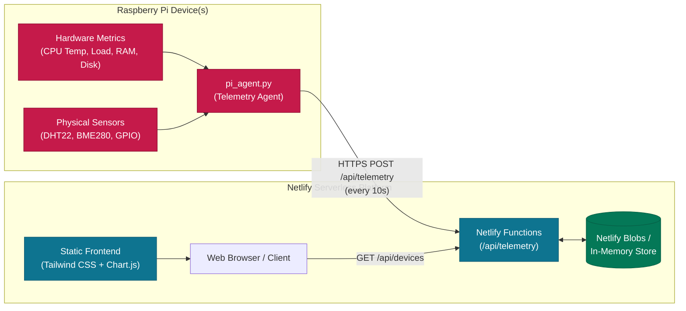

# 🍓 Raspberry Pi IoT Telemetry Hub & Dashboard
## Comprehensive Feature Book & Setup Guidebook

---

## 1. Executive Summary & System Architecture

The **Raspberry Pi IoT Telemetry Hub** is an end-to-end, serverless IoT monitoring platform designed to collect real-time hardware telemetry and sensor data from Raspberry Pi devices and display it on an interactive web dashboard hosted on Netlify.

### 🏗️ Architecture Diagram



---

## 2. 📖 App Feature Book

### 2.1 Fleet Overview & KPI Counters
The dashboard automatically aggregates telemetry across all registered devices:
- **Total Registered Devices**: Instant count of all active and previously seen devices.
- **🟢 Online Devices**: Devices with active heartbeats received within the last 45 seconds.
- **🟡 Warning / Idle Devices**: Devices that haven't sent a heartbeat for 45–120 seconds, or are reporting high CPU temperatures ($\ge 75^\circ\text{C}$).
- **🔴 Offline Devices**: Devices silent for longer than 2 minutes.

### 2.2 Live Hardware Telemetry
When a device is selected from the device strip, the dashboard displays:
- **CPU Thermal Zone**: Live temperature in both Celsius (°C) and Fahrenheit (°F) with color-coded gauge thresholds:
  - Green: $< 60^\circ\text{C}$ (Optimal)
  - Amber: $60^\circ\text{C} - 74^\circ\text{C}$ (Warm)
  - Red: $\ge 75^\circ\text{C}$ (Critical Thermal Warning)
- **CPU Utilization**: Real-time percentage load bar.
- **Memory Consumption**: RAM percentage, used MB, and total MB.
- **Disk Storage**: SD card usage percentage and remaining free storage (GB).
- **System Information**: System uptime, local IP address, hostname, and OS/kernel version.

### 2.3 Attached Environmental Sensor Readings
The dashboard supports extended sensor payloads:
- **Ambient Temperature**: Room/greenhouse temperature (°C).
- **Relative Humidity**: Environmental moisture levels (%).
- **Barometric Pressure**: Atmospheric pressure (hPa).
- **Custom Sensor Inputs**: Soil moisture, light levels (LDR), or GPIO pin states (HIGH/LOW).

### 2.4 Interactive Time-Series Charts
Powered by Chart.js with responsive dark mode aesthetics:
- **Temperature Timeline**: Compares Raspberry Pi CPU core temperature against ambient room temperature over the last 25 readings.
- **System Load Timeline**: Correlates CPU load percentage with RAM utilization over time.

### 2.5 Event Stream & Alert Log
- Displays the 20 most recent system events, state transitions, and critical warnings.
- Automatically generates alerts when devices exceed thermal thresholds or report errors.

### 2.6 Interactive Device Simulator
- A built-in **"Simulate Pi"** button allows testing and demonstration of the dashboard interface without requiring physical hardware online.

---

## 3. 🛠️ Step-by-Step Setup Guidebook

### Part 1: Netlify Deployment
Your website is deployed and configured via GitHub at **[https://rpi11232.netlify.app](https://rpi11232.netlify.app)**.

If deploying to a new site:
1. Push the code to GitHub (`Pizz4Hut/rpitesting`).
2. Log in to [Netlify](https://app.netlify.com) &rarr; **Add new site** &rarr; **Import an existing project**.
3. Select your repository. The build parameters are automatically configured via `netlify.toml`:
   - **Publish directory:** `public`
   - **Functions directory:** `netlify/functions`
4. Click **Deploy Site**.

---

### Part 2: Raspberry Pi Initial Setup

#### 1. Connect to your Raspberry Pi
Open your terminal on your PC/Mac or launch the terminal on the Raspberry Pi:
```bash
ssh pi@<your-raspberry-pi-ip>
```

#### 2. Install Git and System Packages
Ensure `git` and `python3-psutil` are installed on your Raspberry Pi:
```bash
sudo apt update
sudo apt install -y git python3-pip python3-psutil
```

#### 3. Clone the Project Repository
```bash
git clone https://github.com/Pizz4Hut/rpitesting.git
cd rpitesting/pi-client
chmod +x setup.sh && ./setup.sh
```

---

### Part 3: Running the Telemetry Agent

#### Quick Interactive Run
Test the telemetry transmission immediately:
```bash
python3 pi_agent.py \
  --url https://rpi11232.netlify.app/api/telemetry \
  --device-id edge-gateway \
  --device-name "Edge Gateway Pi" \
  --interval 10
```

#### Command Options Reference:
| Option | Description | Default |
| :--- | :--- | :--- |
| `--url` | Full URL to the `/api/telemetry` endpoint | `http://localhost:8888/api/telemetry` |
| `--device-id` | Unique identifier string for this Pi | `rpi-<hostname>` |
| `--device-name` | Display name shown on the web dashboard | `Raspberry Pi (<hostname>)` |
| `--interval` | Transmission frequency in seconds | `10` |
| `--api-key` | Secret key matching `DEVICE_API_KEY` (if set) | None |
| `--config` | Path to JSON config file | None |

---

### Part 4: Configuring 24/7 Autostart (Systemd Service)

To ensure the telemetry agent restarts automatically when the Raspberry Pi boots or if the network drops:

1. **Create the configuration file:**
   ```bash
   cd ~/rpitesting/pi-client
   cp config.json.example config.json
   nano config.json
   ```

2. **Paste your configuration:**
   ```json
   {
     "url": "https://rpi11232.netlify.app/api/telemetry",
     "deviceId": "edge-gateway",
     "deviceName": "Edge Gateway Pi",
     "interval": 10
   }
   ```
   *(Save with `Ctrl + O`, then exit with `Ctrl + X`)*.

3. **Install the Systemd unit:**
   ```bash
   sudo cp pi-agent.service /etc/systemd/system/
   sudo systemctl daemon-reload
   sudo systemctl enable --now pi-agent
   ```

4. **Verify background status:**
   ```bash
   sudo systemctl status pi-agent
   ```

---

### Part 5: Adding Physical Hardware Sensors (GPIO / I2C)

To transmit readings from physical sensors (e.g. DHT11/DHT22, BME280, or DS18B20):

1. Open `pi_agent.py` on your Raspberry Pi:
   ```bash
   nano ~/rpitesting/pi-client/pi_agent.py
   ```
2. Locate the function `read_custom_sensors()`:
   ```python
   def read_custom_sensors():
       """Hook for attached hardware sensors (DHT11/22, BME280, etc.)."""
       # Example: Read from Adafruit DHT22
       # import adafruit_dht, board
       # dht = adafruit_dht.DHT22(board.D4)
       # return {
       #     "ambientTemp": round(dht.temperature, 1),
       #     "humidity": round(dht.humidity, 1),
       #     "pressure": 1013.25
       # }
   ```
3. Save the file and restart the agent (`sudo systemctl restart pi-agent`).

---

## 4. 🔒 API Reference & Security

### Endpoints
- `POST /api/telemetry`: Ingests JSON telemetry payload from Raspberry Pi.
- `GET /api/devices`: Returns device summaries, statuses, and recent alerts.
- `GET /api/devices/:id`: Fetches detailed history for a specific device.
- `DELETE /api/devices/:id`: Deregisters a device from the fleet.
- `POST /api/simulate`: Injects sample telemetry data for testing.
- `GET /api/health`: Health-check endpoint.

### Optional API Key Security
To restrict the API so only your Raspberry Pi can send data:
1. In Netlify: **Site settings &rarr; Environment variables &rarr; Add variable**:
   - `DEVICE_API_KEY`: `your-secret-token-here`
2. In `config.json` on the Raspberry Pi:
   ```json
   {
     "apiKey": "your-secret-token-here"
   }
   ```
   *(Or pass `--api-key your-secret-token-here` in the command line).*
