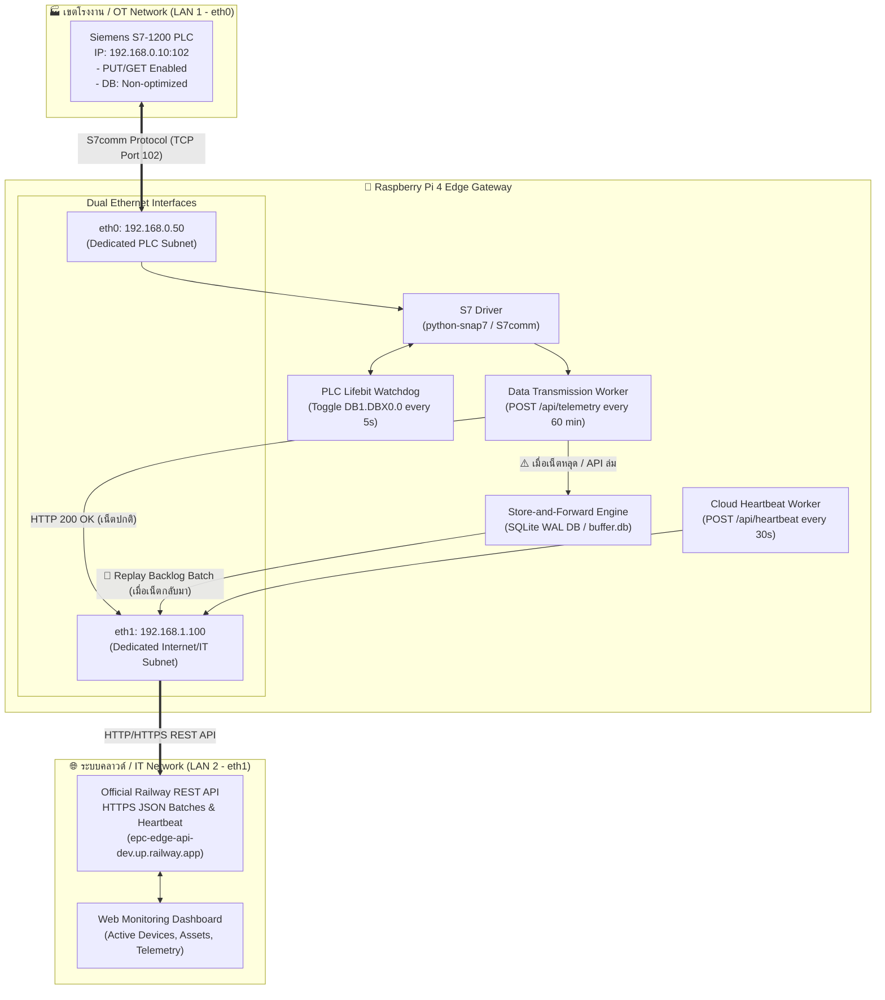

# 🏭 Siemens S7-1200 IoT Edge Gateway บน Raspberry Pi 4
## คู่มือสถาปัตยกรรมระบบ, การตั้งค่า Redundancy, Heartbeat และการเชื่อมต่อ REST API

เอกสารฉบับนี้จัดทำขึ้นตามข้อกำหนดใน **ขอบเขตของงาน (TOR)** โครงการพัฒนาระบบ IoT Edge Gateway สำหรับดึงข้อมูลจากเครื่องจักร (Siemens S7-1200) และเอกสาร **GSP-REQ-2026-000**

---

## 1. 🏗️ สถาปัตยกรรมระบบ (System Architecture)



---

## 2. 🛡️ การจัดการความเสถียรและระบบสำรองข้อมูล (Redundancy Mechanisms)

ตามข้อกำหนดของโครงการที่เน้น **ความเสถียรของข้อมูลและการทำงานต่อเนื่อง**:

### 2.1 Store-and-Forward (ระบบเก็บพักข้อมูลออฟไลน์ ป้องกันข้อมูลสูญหาย 100%)
* **สภาวะปกติ (Online):** ดึงข้อมูล 19 Tags จาก Siemens S7-1200 แล้วยิงขึ้น REST API ทันที
* **สภาวะเน็ตเวิร์กขัดข้อง (Offline / Server Down):**
  * ข้อมูลจะถูกเข้ารหัส JSON และจัดเก็บลงฐานข้อมูลความเร็วสูง **SQLite (`buffer.db`)** ใน SD Card หรือ NVMe SSD อัตโนมัติในสถานะ `pending`
  * รองรับการเก็บพักข้อมูลได้สูงสุด **50,000 รายการ** (เพียงพอต่อการออฟไลน์ได้หลายสัปดาห์)
* **สภาวะเน็ตเวิร์กกลับมาเชื่อมต่อ (Auto-Recovery):**
  * Redundancy Drainer จะตรวจพบสัญญาณอินเทอร์เน็ต และทยอยส่งข้อมูลย้อนหลังขึ้น API เป็นชุด (Batch Replay) ผ่าน `/api/telemetry/batch`
  * ทุกเรคคอร์ดจะคง **Timestamp ดั้งเดิม ณ ขณะเกิดเหตุ** ไม่สูญหายและไม่ผิดเพี้ยนตามลำดับ FIFO

### 2.2 Dual Heartbeat Monitoring (ระบบตรวจสอบสถานะ 2 ทิศทาง)
1. **Gateway ⟷ Cloud Heartbeat:**
   * Gateway ยิงสถานะสุขภาพเครื่อง (CPU Temp, RAM, Disk, Queue Depth, PLC Connection, Dual LAN IPs) ขึ้น Web API ทุกๆ **30 วินาที** (Endpoint: `POST /api/heartbeat`)
   * หาก Gateway ไม่ส่งสัญญาณเกิน 120 วินาที Dashboard จะขึ้นแจ้งเตือนสถานะ 🔴 **Offline**
2. **Gateway ⟷ PLC Heartbeat (PLC Lifebit):**
   * Gateway จะทำการสลับบิต (Toggle Bit เช่น `0 ⟷ 1`) ในตำแหน่ง `DB1.DBX0.0` ทุกๆ **5 วินาที**
   * ในฝั่งโปรแกรม PLC (Ladder Logic) สามารถตั้ง On-Delay Timer (TON) 10-15 วินาที เพื่อจับว่าหากบิตนี้ไม่สลับ แสดงว่า Edge Gateway ดับหรือสายหลุด PLC สามารถส่งเสียง Buzzer/Alarm แจ้งเตือนผู้ควบคุมเครื่องจักรได้ทันที

### 2.3 Hardware & System Watchdog (ป้องกันเครื่องแฮงก์)
* ใช้ **Hardware Watchdog Chip BCM2711** ของ Raspberry Pi 4 ควบคู่กับ `systemd watchdog`
* หากโปรแกรมหรือระบบปฏิบัติการค้างเกิน 60 วินาที ฮาร์ดแวร์จะบังคับรีบูตระบบขึ้นมาทำงานใหม่เองอัตโนมัติ 24/7 โดยไม่ต้องมีช่างไปกดรีเซ็ต

---

## 3. 🏷️ ข้อมูลประจำตัวอุปกรณ์ (Device Profile, Serial Number & MAC Address)

ตามข้อกำหนดใน TOR ข้อ 3.2.2 ฝ่ายไอที/โรงงานอาจต้องใช้ **MAC Address** เพื่อทำ MAC Filtering ในระบบเครือข่าย และฝ่ายควบคุมต้องการให้ระบุ **Device Name** และ **Serial Number** ประจำตัวเครื่องได้อย่างชัดเจน:

### 3.1 การตั้งค่าใน `config_plc.json`
สามารถกำหนดชื่ออุปกรณ์และ Serial Number ได้อย่างยืดหยุ่น:
```json
{
  "deviceId": "edge-prototype-gen1-001",
  "deviceName": "Edge Prototype Gen-1 (Machine Line 1)",
  "serialNumber": "auto",
  "repository": "https://github.com/Pizz4Hut/edge-prototype-gen-1.git"
}
```
* **`deviceName`**: ชื่อเครื่องที่จะปรากฏในระบบ (เช่น "Edge Prototype Gen-1", "Machine Line 1")
* **`serialNumber`**: 
  * หากใส่ `"auto"`: ระบบจะดึงรหัส **Hardware Serial Number ประจำตัวชิป Raspberry Pi 4** จาก `/proc/cpuinfo` มาใช้อัตโนมัติ (ไม่ซ้ำใครแน่นอน)
  * หรือสามารถกำหนดเป็นรหัส Custom ตามป้ายสติ๊กเกอร์ของบริษัทได้ เช่น `"SN-2026-RPI4-001"`

### 3.2 คำสั่งดูข้อมูลฮาร์ดแวร์และ MAC Address แบบรวดเร็ว
บน Raspberry Pi 4 เพียงพิมพ์คำสั่ง:
```bash
python3 plc_gateway.py --info
```
ระบบจะแสดงผล Hardware Profile ทั้งหมดทันที:
```text
=================================================================
🍓 Raspberry Pi 4 Edge Gateway - Hardware & Network Profile
=================================================================
Device Name:     Edge Prototype Gen-1 (Machine Line 1)
Device ID:       edge-prototype-gen1-001
Serial Number:   10000000a1b2c3d4 (Auto-detected from RPi CPU)
-----------------------------------------------------------------
LAN 1 (PLC Network):     eth0
  IP Address:            192.168.0.50
  MAC Address:           b8:27:eb:11:22:33  <-- นำไปลงทะเบียนวง PLC
  Target PLC IP:         192.168.0.10:102
-----------------------------------------------------------------
LAN 2 (Internet / API):  eth1 (หรือ wlan0)
  IP Address:            192.168.1.100
  MAC Address:           00:e0:4c:53:44:55  <-- นำไปลงทะเบียนวง IT/Firewall
=================================================================
```

---

## 4. 🌐 การตั้งค่า Dual Network บน Raspberry Pi 4 (ตาม TOR ข้อ 2.1.1)

เพื่อความปลอดภัยสูงสุดและป้องกันปัญหาระบบ Routing วง OT และ IT จะถูกแยกออกจากกันอย่างเด็ดขาด:

### การตั้งค่า Network Interface (`/etc/network/interfaces` หรือ NetworkManager)

```ini
# LAN 1: ฝั่งต่อตรงกับ Siemens S7-1200 (พอร์ต eth0 ในตัวบอร์ด Pi)
auto eth0
iface eth0 inet static
    address 192.168.0.50
    netmask 255.255.255.0
    # ⚠️ สำคัญมาก: ห้ามใส่ gateway ในฝั่ง PLC เพื่อไม่ให้ route อินเทอร์เน็ตวิ่งหลงทางเข้ามา

# LAN 2: ฝั่งออกอินเทอร์เน็ต / ต่อเข้าสวิตช์โรงงาน (พอร์ต USB-to-LAN eth1 หรือ Wi-Fi)
auto eth1
iface eth1 inet static
    address 192.168.1.100
    netmask 255.255.255.0
    gateway 192.168.1.1
    dns-nameservers 8.8.8.8 1.1.1.1
```

---

## 4. ⚙️ การเตรียมความพร้อมฝั่ง PLC Siemens S7-1200 (Client Responsibilities - TOR ข้อ 3.1)

ผู้ดูแล PLC จะต้องทำการเปิดสิทธิ์ในโปรแกรม **Siemens TIA Portal** ดังนี้:

1. **เปิดฟังก์ชัน PUT/GET Communication:**
   * เปิด TIA Portal &rarr; ไปที่ `Device Configuration` &rarr; ดับเบิ้ลคลิกตัว CPU S7-1200
   * ไปที่แท็บ `Properties` &rarr; `Protection & Security` &rarr; `Connection mechanisms`
   * ติ๊กถูกที่ช่อง **"Permit access with PUT/GET communication from remote partner"**

2. **ปลด Optimized Block Access:**
   * ไปที่ Data Block (DB) ที่ต้องการให้อ่านค่า (เช่น `DB1`)
   * คลิกขวาที่ DB &rarr; เลือก `Properties` &rarr; ไปที่ `Attributes`
   * **เอาเครื่องหมายถูกออก (Uncheck)** จากช่อง **"Optimized block access"** เพื่อให้เป็น Standard Block (Direct Addressing)
   * Compile และ Download ลง PLC

---

## 5. 📋 รายการ Memory Map 19 Tags (ตาม TOR ข้อ 2.2.1)

| Tag ID | ชื่อ Tag | ตำแหน่ง Address | ชนิดข้อมูล | หน่วย | คำอธิบาย |
| :---: | :--- | :---: | :---: | :---: | :--- |
| 1 | `spindle_temperature` | `DB1.DBD0` | REAL (Float32) | °C | อุณหภูมิของหัวสปินเดิลหลัก |
| 2 | `motor_current` | `DB1.DBD4` | REAL (Float32) | A | กระแสไฟฟ้าของมอเตอร์ขับ |
| 3 | `motor_voltage` | `DB1.DBD8` | REAL (Float32) | V | แรงดันไฟฟ้ากระแสสลับ |
| 4 | `hydraulic_pressure` | `DB1.DBD12` | REAL (Float32) | bar | แรงดันระบบไฮดรอลิกส์ |
| 5 | `pneumatic_pressure` | `DB1.DBD16` | REAL (Float32) | bar | แรงดันลมระบบนิวแมติกส์ |
| 6 | `line_speed` | `DB1.DBD20` | REAL (Float32) | m/min | ความเร็วสายพานลำเลียง |
| 7 | `vibration_level` | `DB1.DBD24` | REAL (Float32) | mm/s | ความสั่นสะเทือนของแบริ่ง |
| 8 | `coolant_flow_rate` | `DB1.DBD28` | REAL (Float32) | L/min | อัตราการไหลของน้ำหล่อเย็น |
| 9 | `coolant_temp` | `DB1.DBD32` | REAL (Float32) | °C | อุณหภูมิน้ำหล่อเย็น |
| 10 | `total_production_count`| `DB1.DBD36` | DINT (Int32) | pcs | ยอดผลิตสะสมรวม |
| 11 | `good_parts_count` | `DB1.DBD40` | DINT (Int32) | pcs | จำนวนชิ้นงานที่ผ่านเกณฑ์ |
| 12 | `defect_parts_count` | `DB1.DBD44` | DINT (Int32) | pcs | จำนวนชิ้นงานที่มีข้อบกพร่อง |
| 13 | `cycle_time_current` | `DB1.DBD48` | REAL (Float32) | s | เวลาในการผลิตต่อรอบปัจจุบัน |
| 14 | `cycle_time_target` | `DB1.DBD52` | REAL (Float32) | s | เวลาเป้าหมายต่อรอบมาตรฐาน |
| 15 | `machine_operating_hours`| `DB1.DBD56`| REAL (Float32) | h | ชั่วโมงการทำงานสะสมของเครื่อง |
| 16 | `machine_status_running` | `DB1.DBX60.0` | BOOL (Bit) | state | สถานะเครื่องทำงาน (1=Run, 0=Stop) |
| 17 | `machine_status_fault` | `DB1.DBX60.1` | BOOL (Bit) | state | สัญญาณเตือนเครื่องจักรขัดข้อง |
| 18 | `emergency_stop_ok` | `DB1.DBX60.2` | BOOL (Bit) | state | สวิตช์ฉุกเฉิน E-Stop ปกติ |
| 19 | `active_alarm_code` | `DB1.DBW62` | INT (Int16) | code | รหัสแจ้งเตือนข้อผิดพลาด (Alarm Code) |
| -- | `plc_lifebit_heartbeat` | `DB1.DBX0.0` | BOOL (Bit) | bit | สัญญาณ Lifebit สลับทุก 5 วินาที |

---

## 6. 🚀 วิธีการติดตั้งและรันระบบบน Raspberry Pi 4

### ขั้นตอนที่ 1: ติดตั้งโปรแกรมบน Raspberry Pi 4
เปิด Terminal บน Raspberry Pi 4 หรือ SSH เข้าไป แล้วรันคำสั่ง:

```bash
# 0. ติดตั้ง Git ก่อนเป็นอันดับแรก (กรณี OS ติดตั้งใหม่ยังไม่มี git)
sudo apt update && sudo apt install -y git

# 1. Clone คลังโปรเจกต์
git clone https://github.com/Pizz4Hut/edge-prototype-gen-1.git
cd edge-prototype-gen-1/pi-client

# 2. รันสคริปต์ติดตั้งระบบอัตโนมัติ
chmod +x setup_plc_gateway.sh
./setup_plc_gateway.sh
```

### ขั้นตอนที่ 2: ทดสอบการเชื่อมต่อตู้ PLC S7-1200 จริง (Physical PLC Connection Test)
ระบบทำงานกับตู้ PLC S7-1200 จริงเท่านั้น โดย **ถอดระบบ Simulation (Mock Data) ออกทั้งหมด**:
* หากยังไม่เชื่อมต่อสาย LAN หรือตู้ PLC ดับ: ระบบจะแจ้งเตือนว่า `⚠️ [ไม่มีข้อมูลจาก PLC] ขาดการเชื่อมต่อกับตู้ PLC S7-1200 ที่ IP 192.168.2.2:102! ให้เชื่อมต่อข้อมูลจาก PLC`
* เมื่อเชื่อมต่อสาย LAN กับตู้ PLC จริง: Gateway จะอ่าน 19 Tags และยิงขึ้น Cloud ทันที

```bash
# ทดสอบรัน 1 รอบ (อ่านค่าจริงจาก PLC + ส่ง Cloud Runtime + ยิง Heartbeat)
plc-test

# หรือใช้คำสั่งตรง:
python3 plc_gateway.py --once
```

### ขั้นตอนที่ 3: รันการทดสอบ Burn-in Test 24 ชั่วโมง (TOR ข้อ 2.3.2)
เพื่อสร้างรายงานผลการทดสอบ `simulation_test.log` ยืนยันการตอบรับ **HTTP 200 OK** ต่อเนื่อง:

```bash
python3 plc_simulator.py --hours 24 --interval 10 --log burnin_24h_report.log
```

### ขั้นตอนที่ 4: เปิดใช้งานเป็น Service 24/7 (Systemd Autostart)
```bash
# สั่งเริ่มทำงานทันที
sudo systemctl start plc-gateway

# ดูสถานะการทำงานแบบ Real-time
sudo systemctl status plc-gateway

# ดู Log การอ่านค่าและยิง API
sudo journalctl -u plc-gateway -f
```

### ขั้นตอนที่ 5: ติดตั้งและใช้งาน CLI Toolbox (คำสั่งลัดประจำตู้คอนโทรล)

หากมีการอัปเดตโค้ดบน GitHub ให้ทำการดึงโค้ดล่าสุดลงมาก่อน (ใช้ `git stash` เพื่อป้องกัน Git conflict):
```bash
cd ~/edge-prototype-gen-1/pi-client
git stash
git pull origin main
./install_toolbox.sh
```
* `plc-config` : ⚙️ เมนูตั้งชื่อเครื่อง (Device Name), รหัส UUID, API Key, HTTPS URL และเปิด Web Configurator
* `plc-toolbox` : แสดงสารบัญคำสั่งลัดทั้งหมด
* `plc-runtime` : ดูสถานะ Cloud Runtime สดๆ และ Last Seen At จาก Railway API
* `plc-info` : ดู Hardware Profile, MAC Address, Serial และ Tailscale IP
* `plc-diagnose` : ตรวจสุขภาพระบบอัตโนมัติ 7 จุด (PASS/WARN/FAIL)
* `plc-test` : ทดสอบดึงค่า PLC และยิง API 1 รอบ
* `plc-status` : เช็คสถานะ Background Service 24/7
* `plc-logs` : ดู Live Logs การทำงานแบบ Real-time
* `plc-restart` : รีสตาร์ท Gateway แบบปลอดภัย
* `plc-buffer` : ตรวจสอบจำนวนข้อมูลที่ค้างใน SQLite Offline Queue
* `plc-burnin` : รัน Burn-in Stability Test 24 ชั่วโมง
* `plc-sim` : สตาร์ท PLC Simulator (พอร์ต 102)

#### ตัวอย่างการใช้งาน `plc-config`:
```bash
# 1. เปิด Interactive Wizard ใน Terminal เพื่อตั้งชื่อเครื่องหรือปรับแต่งค่า
plc-config

# 2. ตั้งชื่ออุปกรณ์ (Device Name) แล้วรีสตาร์ท Service ทันที
plc-config --set-name "GSE-PROTO-1" --restart

# 3. ทดสอบเชื่อมต่อ HTTPS Cloud API สดๆ ทันที
plc-config --test

# 4. เปิด Web Configurator ปรับแต่งผ่านหน้าเว็บเบราว์เซอร์ (พอร์ต 8080)
plc-config --web
```

---

## 7. 📡 ตัวอย่าง JSON Payload (Railway Edge Runtime Telemetry & Sensors Package)

### Data Telemetry Batch Payload (`POST /edge/devices/{deviceId}/runtimes/{runtimeId}/batches`):
โครงสร้างข้อมูลส่งขึ้น Railway Cloud API มาพร้อมการระบุ **Sensor Definition** ครบถ้วน (ID, ชื่อเซนเซอร์, Label คำอธิบาย, ตำแหน่ง Memory DB, หน่วย Unit, และค่า Raw Hexadecimal จากตู้ PLC):

```json
{
  "sequence": 1,
  "sequenceRef": "J8N7ZQ-1",
  "collectedAt": "2026-10-15T00:15:00.000Z",
  "events": [
    {
      "timestamp": "2026-10-15T00:15:00.000Z",
      "payload": {
        "pnr_code": "J8N7ZQ",
        "device_id": "4045f327-2776-4f34-977e-64e307db648f",
        "device_name": "GSE-PROTO-1",
        "sensor_count": 19,
        "sensors": [
          {
            "id": 1,
            "name": "spindle_temperature",
            "label": "Main Spindle Temperature",
            "address": "DB1.DBD0",
            "type": "REAL",
            "value": 65.4,
            "unit": "°C",
            "raw_hex": "4282CCD0",
            "quality": "GOOD",
            "timestamp": 1773489600000
          },
          {
            "id": 2,
            "name": "motor_current",
            "label": "Motor Phase Current",
            "address": "DB1.DBD4",
            "type": "REAL",
            "value": 14.8,
            "unit": "A",
            "raw_hex": "416CCE42",
            "quality": "GOOD",
            "timestamp": 1773489600000
          },
          {
            "id": 16,
            "name": "machine_status_running",
            "label": "Machine Run State (1=Running, 0=Stopped)",
            "address": "DB1.DBX60.0",
            "type": "BOOL",
            "value": true,
            "unit": "state",
            "raw_hex": "01",
            "quality": "GOOD",
            "timestamp": 1773489600000
          }
        ],
        "tags": {
          "spindle_temperature": 65.4,
          "motor_current": 14.8,
          "machine_status_running": true
        },
        "plc": {
          "connected": true,
          "ip": "192.168.2.2",
          "port": 102,
          "lifebit_active": true
        },
        "system": {
          "cpuTemp": 48.2,
          "cpuUsage": 13.5,
          "ramUsage": 28.4,
          "diskUsage": 32.1
        }
      }
    }
  ]
}
```

### การตรวจสอบและกำหนดเซนเซอร์ (Define Sensors):
1. **ดูตารางเซนเซอร์ทั้งหมดใน Terminal:**
   ```bash
   plc-config --sensors
   ```
2. **จัดการเซนเซอร์ผ่านเมนู:**
   ```bash
   plc-config
   # เลือกเมนู [S] จัดการแท็กและกำหนดเซนเซอร์
   ```
3. **กำหนดเซนเซอร์ผ่านหน้าเว็บ (Web Configurator):**
   ```bash
   plc-config --web
   # เปิดเบราว์เซอร์ไปที่ http://<ip>:8080 แล้วแก้ไขในตาราง Sensor Definitions & Memory Map ได้ทันที
   ```

### Heartbeat Ping Payload (`POST /api/heartbeat` ทุกๆ 30 วินาที):
```json
{
  "deviceId": "edge-gateway-plc-01",
  "timestamp": 1773489630000,
  "plc": { "connected": true, "ip": "192.168.0.10", "lifebit": 1 },
  "redundancy": { "bufferQueueDepth": 0, "storeAndForwardActive": true },
  "system": { "cpuTemp": 48.1, "cpuUsage": 11.2 }
}
```
